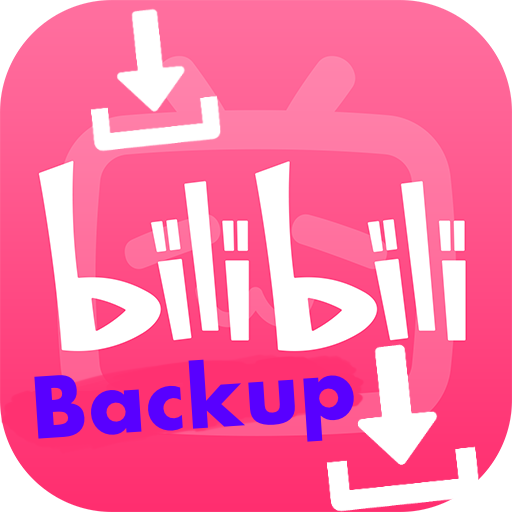

<a name="readme-top"></a>

<!-- PROJECT SHIELDS -->

[![Contributors][contributors-shield]][contributors-url]
[![Forks][forks-shield]][forks-url]
[![Stargazers][stars-shield]][stars-url]
[![Issues][issues-shield]][issues-url]
[![MIT License][license-shield]][license-url]

<!-- PROJECT LOGO -->
<br />
<div align="center">
  <a href="https://github.com/kingwingfly/fav">
    
  </a>

<h3 align="center">fav</h3>

  <p align="center">
    Back up your favorite bilibili resources with CLI.
    <br />
    <a href="https://github.com/kingwingfly/fav"><strong>Explore the docs »</strong></a>
    <br />
    <br />
    <a href="https://github.com/kingwingfly/fav">View Demo</a>
    ·
    <a href="https://github.com/kingwingfly/fav/issues">Report Bug</a>
    ·
    <a href="https://github.com/kingwingfly/fav/issues">Request Feature</a>
  </p>
</div>

<!-- TABLE OF CONTENTS -->
<details>
  <summary>Table of Contents</summary>
  <ol>
    <li>
      <a href="#about-the-project">About The Project</a>
      <ul>
        <li><a href="#built-with">Built With</a></li>
      </ul>
    </li>
    <li>
      <a href="#getting-started">Getting Started</a>
      <ul>
        <li><a href="#prerequisites">Prerequisites</a></li>
        <li><a href="#installation">Installation</a></li>
      </ul>
    </li>
    <li>
      <a href="#usage">Usage</a>
      <ul>
        <li><a href="#quickstart">Quickstart</a></li>
        <li><a href="#examples">Examples</a></li>
        <li><a href="#configuration">Configuration</a></li>
        <li><a href="#shell-completions">Shell Completions</a></li>
        <li><a href="#scheduling">Scheduling</a></li>
      </ul>
    </li>
    <li><a href="#develop">Develop</a></li>
    <li><a href="#contributing">Contributing</a></li>
    <li><a href="#license">License</a></li>
    <li><a href="#contact">Contact</a></li>
    <li><a href="#acknowledgments">Acknowledgments</a></li>
  </ol>
</details>

<!-- ABOUT THE PROJECT -->

## About The Project

[![Product Name Screen Shot][product-screenshot]](https://github.com/kingwingfly/fav)

批量备份收藏夹/up主视频。

Back up your favorite bilibili online resources with CLI.

⚠️: There's a breaking change between v0 and v1, details in [CHANGELOG.md](CHANGELOG.md).

<p align="right">(<a href="#readme-top">back to top</a>)</p>

### Built With

- [![Rust][Rust]][Rust-url]

<p align="right">(<a href="#readme-top">back to top</a>)</p>

<!-- GETTING STARTED -->

## Getting Started

### Prerequisites

- **Runtime only:** [`ffmpeg`](https://ffmpeg.org/) installed and available on your `PATH` (or configured via `ffmpeg_path` in `.fav/config.toml`).
- **No build-time FFmpeg or `pkgconf` required:** `fav` invokes the `ffmpeg` CLI subprocess rather than dynamically linking `libav*`, so prebuilt binaries work across Linux (`x86_64` & `aarch64`), macOS (`aarch64`), and Windows (`x86_64`) without library ABI/SONAME mismatches. Run `fav doctor` anytime to verify your environment.

### Installation

1. **Download a prebuilt release binary** from [GitHub Releases](https://github.com/kingwingfly/fav/releases) (binary name is `fav`; verify downloads with `SHA256SUMS`).
2. **Install from crates.io** (installs the `fav` binary with zero C/FFmpeg build dependencies):
   ```sh
   cargo install fav_bili
   ```
3. **Compile from source:**
   ```sh
   git clone https://github.com/kingwingfly/fav.git
   cd fav
   cargo build --release
   # binary: target/release/fav
   ```

For Arch Linux users, an unofficial AUR package (`fav-git`) may also be available.

<p align="right">(<a href="#readme-top">back to top</a>)</p>

<!-- USAGE EXAMPLES -->

## Usage

```sh
Back up your favorite bilibili online resources with CLI.

Usage: fav [OPTIONS] [COMMAND]

Commands:
  init        Initialize a fav workspace in the target directory
  auth        Authenticate and manage Bilibili accounts
  list        List accounts/sets/ups/medias, or show workspace status when run bare [alias: ls, l]
  activate    Activate accounts, favorite sets, or UPs for syncing [alias: active, a]
  deactivate  Deactivate accounts, favorite sets, or UPs [alias: d]
  fetch       Fetch metadata of followed UPs, favorite sets, and medias [alias: f]
  pull        Download and mux pending medias from activated sets/UPs (use `fav download` for untracked videos) [alias: p]
  sync        Fetch metadata and pull pending medias in one command [alias: s]
  download    Download arbitrary Bilibili videos/audio without modifying the workspace DB [alias: dl]
  like        Like (or unlike) Bilibili medias by BVID/AID/URL, set, or stdin
  status      Show workspace summary, media counts, and top UPs
  doctor      Diagnose workspace DB, permissions, ffmpeg, disk sync, and account cookies
  media       Manage tracked media states (reset or skip)
  schedule    Generate (or install) user-level recurring sync schedules
  completion  Generate shell completion scripts (with optional dynamic DB completion)
  help        Print this message or the help of the given subcommand(s)

Options:
  -v, --verbose...       Increase log verbosity (-v debug, -vv trace)
  -q, --quiet            Suppress informational logs and next-step hints
  -C, --dir <dir>        Workspace directory containing .fav/ (overrides FAV_DIR)
      --color <color>    Colorize output [default: auto] [possible values: auto, always, never]
      --no-progress      Disable interactive progress bars
      --non-interactive  Disable interactive prompts and TTY pickers
  -h, --help             Print help
  -V, --version          Print version
```

Logs and progress bars are written to `stderr`, keeping `stdout` clean for tables and machine-readable `--format` output. Exit codes distinguish outcomes (`0` ok, `1` runtime error, `2` usage/argument error, `3` auth/cookie failure, `4` partial batch failure).

### Quickstart

1. Authenticate an account via QR code or browser cookies (`--stdin` avoids shell history leaks):
   ```sh
   fav auth login --fetch
   # or paste cookies safely via stdin (recommended if you want to use `fav like` / remote `logout`)
   fav auth usecookies --stdin
   ```
2. Inspect your favorite sets and followed UPs, then activate the ones you want to back up:
   ```sh
   fav ls set
   # Opens an interactive fuzzy multi-select picker on a TTY:
   fav activate set
   # Or specify IDs / name substrings non-interactively:
   fav activate set 123456789
   fav activate up 987654321
   ```
3. Run a full fetch + download sync:
   ```sh
   fav sync
   ```
4. Check progress or diagnose issues:
   ```sh
   fav status
   fav doctor
   ```

### Examples

```sh
# Authenticate with cookies from a file (raw Cookie header or Netscape cookies.txt)
fav auth usecookies --file cookies.txt

# Check cookie validity (defaults to all active accounts, or pass -a / specific IDs)
fav auth check
fav auth check -a

# Run commands against another workspace directory without `cd`
fav -C /data/bilibili status
FAV_DIR=/data/bilibili fav sync

# Interactive TTY fuzzy picker (on non-TTY / --non-interactive, fails with exit code 2 + usage hint)
fav activate set
fav deactivate up

# Inspect created folders, collected folders, and video collections/seasons
fav ls set --kind created
fav ls set --kind collected
fav ls set --kind season

# Incremental cursor fetch (stops at first already-fetched item; resumes interrupted initial scans)
fav fetch
fav sync --prune
# Explicit full scan to refresh expired/unfavorited status across all pages
fav fetch --full
fav fetch --refresh-status --prune --dry-run

# Targeted pull of tracked & active medias (for untracked videos, use `fav download`)
fav pull BV17x411w7KC
fav pull --set 123456789 --jobs 4 --limit-rate 5M --clarity 1080p --codec hevc
fav pull --sound-only --audio-format mp3
fav pull --retry-failed --dry-run

# Archive-safe default vs rename-safe deleted-file recovery (relinks renamed/moved files, re-downloads only missing pages)
fav pull --recheck
fav sync --recheck
fav doctor -o ./videos
fav media reset --missing -o ./videos

# Untracked one-off downloads (`fav download` / `fav dl`) — zero SQLite writes and zero workspace lock
fav download BV1Q541167Qg
fav dl "https://www.bilibili.com/video/BV1Q541167Qg/?p=2"        # downloads only P2
fav dl "https://www.bilibili.com/video/BV1Q541167Qg/?p=2" --all-pages
fav dl BV1Q541167Qg --page 1,3-5 -o ./downloads --clarity 720p --codec avc
fav dl BV1Q541167Qg --sound-only --audio-format flac
fav dl BV1Q541167Qg --anonymous                                   # skip workspace cookies (uses try_look=1)
printf '%s\n' BV17x411w7KC BV1Q541167Qg | fav dl -

# Inspect and filter lists in table, JSON, JSONL, TSV, or plain IDs
fav ls media --state pending --format table
fav ls media --state failed --format json
fav ls media --set 123456789 --format ids
fav ls set --sort count --format tsv

# Recover or skip stuck media items without touching SQLite manually
fav media reset --failed
fav media reset --missing
fav media skip 170001

# Like (or unlike) medias directly by set, BVID/URL, or piped IDs
fav like --set 123456789
fav like BV17x411w7KC
fav ls media --set 123456789 --format ids | fav like -
fav like --unlike BV17x411w7KC
```

### Configuration

`fav` locates your workspace in the following order:

1. `-C, --dir <PATH>`
2. `FAV_DIR` environment variable
3. Walking upward from the current directory to find an existing `.fav/fav.db`
4. Default workspace directory

Persistent defaults are loaded by merging `~/.config/fav/config.toml` and `<workspace>/.fav/config.toml`:

```toml
# .fav/config.toml
output_dir = "./videos"
tmp_dir = "./.fav/tmp"     # On-disk staging directory (never uses /tmp; avoids tmpfs OOM)
jobs = 4
limit_rate = "10M"
clarity = "1080p"          # Alias: quality (best, 8k, dolby, hdr, 4k, 1080p60, 1080p+, ai, 1080p, 720p60, 720p, 480p, 360p, 240p, worst, or numeric qn)
codec = "hevc"             # Preferred DASH codec: avc (h264), hevc (h265), av1
sound_only = false         # Download audio stream only by default
audio_format = "copy"      # copy, m4a, mp3, flac, opus
recheck = false            # Recheck disk for missing/renamed Completed files on pull/sync
prune = false
no_progress = false
color = "auto"
ffmpeg_path = "/usr/bin/ffmpeg"
api_concurrency = 4
```

### Shell Completions

`fav completion <shell>` generates shell completion scripts with built-in dynamic workspace DB completions powered by the hidden `fav __complete` helper (completing set IDs, UP IDs, account IDs, and medias directly from your workspace DB, and forwarding `-C`/`--dir` in Bash, Zsh, Fish, and PowerShell). Pass `--static` to emit static completions only, or `--bin-name <NAME>` if installed under another binary name:

```sh
# Bash
fav completion bash > ~/.local/share/bash-completion/completions/fav

# Zsh
fav completion zsh > ~/.zfunc/_fav

# Fish
fav completion fish > ~/.config/fish/completions/fav.fish

# PowerShell (dynamic Register-ArgumentCompleter with static fallback)
fav completion powershell | Out-String | Invoke-Expression

# Nushell (save and source from config.nu; `nu` alias also accepted)
fav completion nushell | save -f ~/.config/nushell/fav.nu
# Add to ~/.config/nushell/config.nu:
#   source ~/.config/nushell/fav.nu

# Static-only completions (without dynamic DB hooks)
fav completion bash --static > ~/.local/share/bash-completion/completions/fav
```

### Scheduling

Use `fav schedule` to generate (or install) periodic `fav sync` jobs without writing unit files by hand:

```sh
# Preview user systemd service + timer units (no sudo required)
fav schedule --target systemd --interval 3h

# Install into ~/.config/systemd/user/ and print systemctl --user enable instructions
fav schedule --target systemd --interval 3h --install

# macOS launchd plist (preview or install to ~/Library/LaunchAgents/)
fav schedule --target launchd --interval 3h --install

# Windows Task Scheduler PowerShell script
fav schedule --target task-scheduler --interval 3h
```

<p align="right">(<a href="#readme-top">back to top</a>)</p>

<!-- DEVELOP -->

## Develop

Run the same checks enforced by CI:

```sh
cargo fmt --all -- --check
cargo clippy --workspace --all-targets --all-features -- -D warnings
cargo test --workspace --locked
```

`sea-orm-cli` is used to regenerate database entities after adding a new migration:

```sh
cargo binstall sea-orm-cli # or `cargo install sea-orm-cli`
# Regenerates fav_bili/src/entity/entity_inner/ using an isolated temp SQLite DB
./sea-orm.sh
```

See [`.env.example`](.env.example) if you invoke `sea-orm-cli` manually.

<p align="right">(<a href="#readme-top">back to top</a>)</p>

<!-- CONTRIBUTING -->

## Contributing

Contributions are what make the open source community such an amazing place to learn, inspire, and create. Any contributions you make are **greatly appreciated**. Moreover, it is recommended to open an issue before coding to avoid repeated and useless work.

If you have a suggestion that would make this better, please fork the repo and create a pull request. You can also simply open an issue with the tag "enhancement".
Don't forget to give the project a star! Thanks again!

<p align="right">(<a href="#readme-top">back to top</a>)</p>

<!-- LICENSE -->

## License

Distributed under the MIT License. See [`LICENSE`](LICENSE) for more information.

<p align="right">(<a href="#readme-top">back to top</a>)</p>

<!-- CONTACT -->

## Contact

Louis - 836250617@qq.com

Project Link: [https://github.com/kingwingfly/fav](https://github.com/kingwingfly/fav)

<p align="right">(<a href="#readme-top">back to top</a>)</p>

<!-- ACKNOWLEDGMENTS -->

## Acknowledgments

- [bilibili-API-collect](https://github.com/SocialSisterYi/bilibili-API-collect)

<p align="right">(<a href="#readme-top">back to top</a>)</p>

<!-- MARKDOWN LINKS & IMAGES -->
<!-- https://www.markdownguide.org/basic-syntax/#reference-style-links -->

[contributors-shield]: https://img.shields.io/github/contributors/kingwingfly/fav.svg?style=for-the-badge
[contributors-url]: https://github.com/kingwingfly/fav/graphs/contributors
[forks-shield]: https://img.shields.io/github/forks/kingwingfly/fav.svg?style=for-the-badge
[forks-url]: https://github.com/kingwingfly/fav/network/members
[stars-shield]: https://img.shields.io/github/stars/kingwingfly/fav.svg?style=for-the-badge
[stars-url]: https://github.com/kingwingfly/fav/stargazers
[issues-shield]: https://img.shields.io/github/issues/kingwingfly/fav.svg?style=for-the-badge
[issues-url]: https://github.com/kingwingfly/fav/issues
[license-shield]: https://img.shields.io/github/license/kingwingfly/fav.svg?style=for-the-badge
[license-url]: https://github.com/kingwingfly/fav/blob/master/LICENSE
[product-screenshot]: images/screenshot.png
[Rust]: https://img.shields.io/badge/Rust-000000?style=for-the-badge&logo=Rust&logoColor=orange
[Rust-url]: https://www.rust-lang.org
